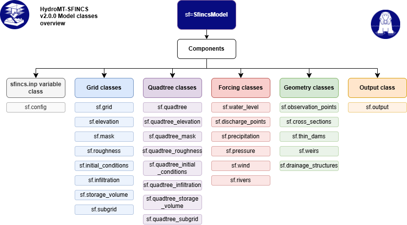

.. _model_components:

Model Components
================

The :py:class:`~hydromt_sfincs.SfincsModel` consists of components that together represent
the SFINCS model setup. Each component manages a specific part of the model and exposes
its relevant data through a ``data`` attribute. Grid-layer data is shared through
``model.grid.data`` or ``model.quadtree_grid.data``, while other components (e.g. geometries or boundary conditions) keep their own
data. Components load and persist data with ``read()`` and ``write()``. Each component
also provides methods to create or update its data, typically named ``create()`` or
``create_*()`` (see :ref:`model_methods`).

For grid-layer components, ``component.data`` is a component-specific view of
the layers stored on the shared grid; it is not a separate copy or storage
location. For example, ``model.elevation.data`` exposes the regular-grid
``dep`` layer, while ``model.grid.data`` contains ``dep`` together with the
other grid layers. Likewise, ``model.quadtree_elevation.data`` exposes ``z``
from ``model.quadtree_grid.data``. Use the parent grid's ``set()`` method to
add or replace a layer; the component's ``data`` view is for accessing its
relevant data.

.. warning::

  **Grid read/write behavior has changed.** ``model.grid.read()`` and
  ``model.quadtree_grid.read()`` read the grid's main data files by default
  (mask and elevation for regular grids; the main mesh file including mask and elevation for quadtree grids).
  The normal way to read or write additional gridded variables is through their
  component methods, such as ``model.roughness.read()`` or
  ``model.infiltration.write()``. As a shortcut, pass ``read_components=True``
  or ``write_components=True`` to have the grid call the read/write methods of
  components that manage gridded variables. ``model.read()`` and
  ``model.write()`` continue to read or write all active model components.

An overview of all model components is presented in :ref:`hydromt_sfincs_diagram`, and each component
will be introduced in the following sections. For more details about each component,
see the `SFINCS documentation <https://sfincs.readthedocs.io/en/latest/>`_.

.. _hydromt_sfincs_diagram:

   HydroMT-SFINCS workflow diagram

Configuration component
-----------------------
The configuration component manages the main SFINCS configuration settings and parameters. Only files or settings
that are mentioned in the configuration file will be used by the SFINCS model.

.. list-table::
   :widths: 25 35 40
   :header-rows: 1

   * - **Component**
     - **Description**
     - **Associated Files / Relations**
   * - :py:class:`config <hydromt_sfincs.components.config.config.SfincsConfig>`
     - Model configuration settings and parameters.
     - ``sfincs.inp`` (main input file)

.. _config_keywords_versions:

Renamed keywords and SFINCS versions
^^^^^^^^^^^^^^^^^^^^^^^^^^^^^^^^^^^^
Some ``sfincs.inp`` keywords were renamed in newer SFINCS versions, for example ``wvmfile``
became ``wavemaker_wvmfile``. HydroMT-SFINCS stores each setting under its current name. The
old name is a *legacy alias*: you can still use it when reading a file or calling
``config.set()`` and ``config.get()``. Each legacy alias records the last SFINCS version in
which it was the keyword.

By default, what is read is what is written: HydroMT-SFINCS remembers the keyword each
setting was read or set with, and writes the setting back under that keyword. A keyword is
only changed, always with a warning, when:

* the file has a ``sfincs_version`` that does not read the keyword. The keyword is then
  replaced by the one that version reads (for example ``wvmfile`` by ``wavemaker_wvmfile``
  for ``sfincs_version = 2.5.0``), or removed if that version does not know the setting;
* the file has no ``sfincs_version`` and the keyword is older than the minimum supported
  SFINCS version (for example ``crs``, which is replaced by ``epsg``).

Without ``sfincs_version`` the targeted SFINCS version is unknown, so settings that are
deprecated in newer versions (for example ``storeqdrain``) are kept without a warning. With
``sfincs_version``, settings that version does not support are removed with a warning.

Writing does not update a model to a newer SFINCS version: ``update_to_latest`` is ``False``
by default, also when the model is written with ``model.write()``. To update a model to the
latest SFINCS version, write the config with ``update_to_latest=True``:

.. code-block:: python

    model = SfincsModel(root="old_model", mode="r")
    model.read()
    model.root.set("updated_model", mode="w+")
    model.write()
    model.config.write(update_to_latest=True)

This writes the current keywords, leaves out deprecated settings and writes
``sfincs_version``. The configuration in memory is not changed. New models always get the
latest ``sfincs_version``. A model that was read without ``sfincs_version`` only gets one when
it is written with ``update_to_latest=True``.

.. mermaid::

   flowchart TD
       subgraph READ["Reading sfincs.inp"]
           R0["Keyword in file e.g. 'wvmfile' or 'wavemaker_wvmfile'"] --> R1{"Is it an old name of a setting?"}
           R1 -- yes --> R2{"Current name, or an old name the kernel reads first, also in the file?"}
           R2 -- yes --> R3["This name ignored warning"]
           R2 -- no --> R4["Stored under the current name, keyword remembered"]
           R1 -- no --> R6
           R4 --> R6{"Known setting?"}
           R6 -- no --> R7["Kept and rewritten as is warning: unrecognized key"]
           R6 -- yes --> R8{"sfincs_version in file?"}
           R8 -- no --> R13{"Keyword older than the minimum supported version?"}
           R13 -- no --> R12["Keyword kept"]
           R13 -- yes --> R14["Replaced by the current name warning"]
           R8 -- yes --> R9{"Keyword read by this version?"}
           R9 -- yes --> R12
           R9 -- no --> R10{"Another keyword read by this version?"}
           R10 -- yes --> R15["Replaced by that keyword warning"]
           R10 -- no --> R11["Removed warning: not supported"]
       end

       subgraph SETGET["config.set() / config.get()"]
           S0["Old or current name"] --> S1["Stored under the current name, keyword checked as when reading"]
       end

       R12 --> M[("Model configuration with the keyword per setting")]
       R14 --> M
       R15 --> M
       R7 --> M
       S1 --> M

       subgraph WRITE["Writing sfincs.inp"]
           M --> W0{"update_to_latest?"}
           W0 -- no --> W1["Written under the keyword it was read or set with"]
           W0 -- yes --> W2["Written under the current name, deprecated settings left out, sfincs_version written"]
       end

The diagram leaves out the general write rules: a setting is only written when it has a value,
and only when it differs from its default, was set explicitly, or is always required.

Regular grid components
-----------------------
These components define the model grid and its physical parameters for SFINCS models on regular grids.
The different components are interrelated, since they all share the same spatial grid definition.

.. list-table::
   :widths: 25 35 40
   :header-rows: 1

   * - **Component**
     - **Description**
     - **Associated Files / Relations**
   * - :py:class:`grid <hydromt_sfincs.components.grid.regulargrid.SfincsGrid>`
     - Base model grid.
     - ``sfincs.inp``
   * - :py:class:`elevation <hydromt_sfincs.components.grid.elevation.SfincsElevation>`
     - Elevation (bathymetry/topography).
     - ``depfile``
   * - :py:class:`mask <hydromt_sfincs.components.grid.mask.SfincsMask>`
     - Active domain and boundary mask.
     - ``mskfile``, ``indexfile``
   * - :py:class:`roughness <hydromt_sfincs.components.grid.roughness.SfincsRoughness>`
     - Manning’s n roughness.
     - ``manningfile``
   * - :py:class:`infiltration <hydromt_sfincs.components.grid.infiltration.SfincsInfiltration>`
     - Infiltration capacity.
     - ``qinffile``, ``scsfile``, ``ksfile``, ``sefffile``, ``smaxfile``
   * - :py:class:`initial_conditions <hydromt_sfincs.components.grid.initial_conditions.SfincsInitialConditions>`
     - Initial water levels.
     - ``inifile``
   * - :py:class:`storage_volume <hydromt_sfincs.components.grid.storage_volume.SfincsStorageVolume>`
     - Storage volume to account for green infrastructure.
     - ``volfile``
   * - :py:class:`subgrid <hydromt_sfincs.components.grid.subgrid.SfincsSubgridTable>`
     - Subgrid table with cell-specific elevation and roughness data.
     - ``sbgfile``

.. note::

    Please be aware that the ``indexfile`` is not describing a grid variable.
    Instead, it is generated during the writing process based on the ``mskfile``,
    and it is utilized for the purpose of reading grid variables in binary files.

.. note::

    The regular-grid subgrid-table component is an exception: its table data is
    stored in its own ``data`` attribute. Other regular-grid layer data is
    stored in the shared :py:class:`grid <hydromt_sfincs.components.grid.regulargrid.SfincsGrid>`
    dataset and exposed through each layer component's filtered ``data`` view.

Quadtree grid components
------------------------
These components define the mesh and physical parameters for quadtree SFINCS models.
The main mesh file stores the mesh, elevation, mask and quadtree-specific variables.
Additional gridded variables are read and written through their components and stored
in separate UGRID NetCDF files.

.. list-table::
   :widths: 35 65
   :header-rows: 1

   * - **Component**
     - **Description**
   * - :py:class:`quadtree_grid <hydromt_sfincs.components.quadtree.quadtree.SfincsQuadtreeGrid>`
     - Main quadtree mesh file, including the mask, elevation and quadtree-specific variables not stored in component-specific files (``qtrfile``, default ``sfincs.nc``).
   * - :py:class:`quadtree_elevation <hydromt_sfincs.components.quadtree.quadtree_elevation.SfincsQuadtreeElevation>`
     - Elevation (bathymetry/topography) on the quadtree mesh.
   * - :py:class:`quadtree_mask <hydromt_sfincs.components.quadtree.quadtree_mask.SfincsQuadtreeMask>`
     - Active domain and boundary mask on the quadtree mesh.
   * - :py:class:`quadtree_roughness <hydromt_sfincs.components.quadtree.quadtree_roughness.SfincsQuadtreeRoughness>`
     - Manning's n roughness (``manningfile``).
   * - :py:class:`quadtree_infiltration <hydromt_sfincs.components.quadtree.quadtree_infiltration.SfincsQuadtreeInfiltration>`
     - Infiltration layers, including runoff coefficient and bucket parameters (``inffile``).
   * - :py:class:`quadtree_initial_conditions <hydromt_sfincs.components.quadtree.quadtree_initial_conditions.SfincsQuadtreeInitialConditions>`
     - Initial water levels (``inifile``).
   * - :py:class:`quadtree_storage_volume <hydromt_sfincs.components.quadtree.quadtree_storage_volume.SfincsQuadtreeStorageVolume>`
     - Storage volume layer (``volfile``).
   * - :py:class:`quadtree_subgrid <hydromt_sfincs.components.quadtree.quadtree_subgrid.SfincsQuadtreeSubgridTable>`
     - Subgrid table (``sbgfile``).
   * - :py:class:`quadtree_snapwave_mask <hydromt_sfincs.components.quadtree.snapwave_quadtree_mask.SnapWaveQuadtreeMask>`
     - Optional SnapWave mask on the quadtree mesh.

Geometries and structures
-------------------------
These model components manage vector-based geometries and structures within the SFINCS model, such as
observation points to monitor water levels at specific locations or weirs to represent flow control structures.

.. list-table::
   :widths: 25 35 40
   :header-rows: 1

   * - **Component**
     - **Description**
     - **Associated Files / Relations**
   * - :py:class:`observation_points <hydromt_sfincs.components.geometries.observation_points.SfincsObservationPoints>`
     - Observation points for validation.
     - ``obsfile``
   * - :py:class:`cross_sections <hydromt_sfincs.components.geometries.cross_sections.SfincsCrossSections>`
     - Cross-section definitions.
     - ``crsfile``
   * - :py:class:`weirs <hydromt_sfincs.components.geometries.weirs.SfincsWeirs>`
     - Weir locations and parameters.
     - ``weirfile``
   * - :py:class:`thin_dams <hydromt_sfincs.components.geometries.thin_dams.SfincsThinDams>`
     - Thin dams and barriers.
     - ``thdfile``
   * - :py:class:`drainage_structures <hydromt_sfincs.components.geometries.drainage_structures.SfincsDrainageStructures>`
     - Drainage infrastructure.
     - ``drnfile``

Forcing components
------------------
These components handle time-varying boundary and meteorological forcings applied to the model, such as
water level boundaries, discharge sources, precipitation, wind, and atmospheric pressure.

.. list-table::
   :widths: 25 35 40
   :header-rows: 1

   * - **Component**
     - **Description**
     - **Associated Files / Relations**
   * - :py:class:`water_level <hydromt_sfincs.components.forcing.water_level.SfincsWaterLevel>`
     - Water level boundary conditions.
     - ``bndfile``, ``bzsfile``, ``netbndbzsbzifile``
   * - :py:class:`discharge_points <hydromt_sfincs.components.forcing.discharge_points.SfincsDischargePoints>`
     - Discharge source terms.
     - ``srcfile``, ``disfile``, ``netsrcdisfile``
   * - :py:class:`precipitation <hydromt_sfincs.components.forcing.meteo.SfincsPrecipitation>`
     - Spatially and/or temporally variable rainfall.
     - ``prcfile``, ``netamprfile``
   * - :py:class:`wind <hydromt_sfincs.components.forcing.meteo.SfincsWind>`
     - Spatially and/or temporally variable wind forcing.
     - ``wndfile``, ``netamuamvfile``
   * - :py:class:`pressure <hydromt_sfincs.components.forcing.meteo.SfincsPressure>`
     - Atmospheric pressure fields.
     - ``netampfile``
   * - :py:class:`rivers <hydromt_sfincs.components.forcing.rivers.SfincsRivers>`
     - River network and flow attributes.
     - ``No associated SFINCS files``

.. note::

    The :py:class:`rivers <hydromt_sfincs.components.forcing.rivers.SfincsRivers>` component is not directly used by the SFINCS model,
    but it can be helpful for setting up discharge boundary conditions based on river network data.

Output component
----------------

.. list-table::
   :widths: 25 35 40
   :header-rows: 1

   * - **Component**
     - **Description**
     - **Associated Files / Relations**
   * - :py:class:`output <hydromt_sfincs.components.output.SfincsOutput>`
     - Model simulation results
     - ``sfincs_his.nc``, ``sfincs_map.nc``
